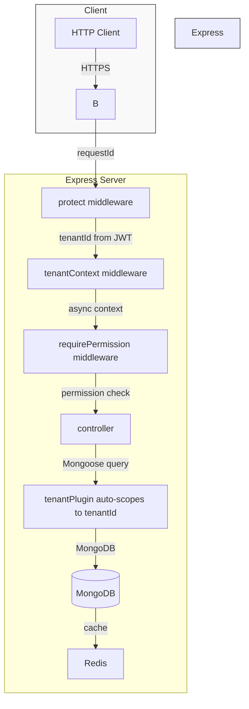

# Multi-Tenant SaaS Backend

[](https://github.com/rohan22punj-cmd/Multi-tenant-saas-/actions)
[](https://nodejs.org/)
[](https://opensource.org/licenses/ISC)

## The Problem

Multiple companies share one server and one database, but each company's data must be completely invisible to every other company. This is hard because a single missing `WHERE tenantId = ...` clause in any controller silently leaks data to other tenants. In Phase 2–3 the framework (Express + Mongoose) gives you nothing by default — every `find`, `update`, `delete` must remember to filter. One overlooked line and a user can read or modify another company's data.

**Bad case**: A developer builds `GET /api/projects/:id` that looks up a project by `_id` only, without scoping to the tenant. Any authenticated user from any company can read any project in the system.

## Solution

- **Isolation in the data layer, not controllers** — the Mongoose tenant plugin automatically scopes every query to the current tenant from AsyncLocalStorage. Controllers never pass `tenantId` manually.
- **Permissions as code constants** — permission keys live in `src/constants/permissions.js`, not in a database table. Roles hold arrays of these keys; the `requirePermission` middleware checks keys, not role names.
- **Hashed refresh and invite tokens** — never store raw tokens. If the database leaks, attackers only see hashes.
- **Exactly-once webhooks** — claimed with `findOneAndUpdate` on `usedAt=null` so concurrent requests can never both succeed.
- **JWT access tokens for 15 minutes** — the token carries `tenantId` and `roleId`; the plugin scopes everything while the token is valid.

## Features

| Feature | Status | Where |
|---------|--------|-------|
| Tenant isolation (plugin-scoped queries) | Built | `src/plugins/tenantPlugin.js` |
| RBAC with permission keys | Built | `src/constants/permissions.js` |
| JWT access + refresh tokens | Built | `src/services/authService.js` |
| Password reset flow | Built | `src/services/authService.js` |
| Rate limiting (auth + general) | Built | `src/middleware/rateLimiter.js` |
| Invite flow (public + accept-invite) | Built | `src/routes/authRoutes.js` |
| Project CRUD with per-project permissions | Built | `src/routes/projectRoutes.js` |
| Task CRUD inside projects | Built | `src/routes/taskRoutes.js` |
| OpenAPI spec validation | Built | `tests/openapi.test.js` |
| CI (test, audit, docker jobs) | Built | `.github/workflows/ci.yml` |
| Dependabot (weekly npm updates) | Built | `.github/dependabot.yml` |
| API docs (Swagger at /api/docs) | Planned | `src/docs/openapi.yaml` |
| Email verification / welcome emails | Planned | — |
| Frontend UI | Planned | — |
| Stripe billing (live prices) | Planned | — |
| Member deactivation / reactivation | Built | `src/controllers/userController.js` |

## Architecture



### Request walk-through: `GET /api/projects`

1. **Client** sends `Authorization: Bearer <jwt>` over HTTPS.
2. **Express** receives request.
3. **protect** middleware verifies the JWT signature, reads `tenantId` and `roleId` from the payload, attaches `req.user` with `{ userId, tenantId, roleId, permissions }`.
4. **tenantContext** middleware pushes `tenantId` into AsyncLocalStorage (`runWithTenant`).
5. **requirePermission** (e.g. `PROJECT_READ`) checks `req.user.permissions` contains the key.
6. **Project controller** runs `Project.find()` — the tenant plugin automatically rewrites the query to `{ tenantId: <current>, ... }`. No `WHERE` clause in the controller.
7. **MongoDB** returns only the current tenant's projects.
8. **Response** is sent back through the middleware chain to the client.

## Tech Stack

| Choice | Reason |
|--------|--------|
| Node.js + Express (ES modules) | Modern, widely supported; ES module type in package.json |
| MongoDB + Mongoose | Document model fits per-tenant data; compound unique index `{tenantId, email}` |
| Mongoose tenant plugin | Auto-scopes every query — no manual `tenantId` in controllers |
| JWT (access + refresh) | Standard, stateless; access tokens expire in 15 min, rotation + reuse detection |
| Redis (ioredis) | Webhook idempotency cache; claim token with `findOneAndUpdate` |
| Permission keys (constant file) | One source of truth; grep for any key and find every place it's checked |
| AsyncLocalStorage (tenant context) | Per-request context without threading `tenantId` through every function |
| Docker Compose | One command `docker compose up` brings up MongoDB + Redis + app |

## Quick start

```bash
# 1. Clone and set up
git clone https://github.com/rohan22punj-cmd/Multi-tenant-saas-.git
cd Multi-tenant-saas-
cp .env.example .env

# 2. Start MongoDB + Redis + app via Docker
docker compose up --build -d

# 3. The app starts on http://localhost:3000

# 3. Run tests
npm test           # Jest with mongodb-memory-server
npm run test:ci    # CI‑style test run

# URLs
API:           http://localhost:3000
Health:        GET /health → { status: 'ok' }
API docs:      http://localhost:3000/api/docs   (Swagger UI)
```

## Try it (copy‑paste flow)

```bash
# 1. Sign up a company + admin
curl -X POST http://localhost:3000/api/auth/signup \
  -H "Content-Type: application/json" \
  -d '{"companyName":"Acme Corp","adminName":"Alice Admin","email":"alice@acme.com","password":"SecureP@ss123"}'

# 2. Log in as the admin
curl -X POST http://localhost:3000/api/auth/login \
  -H "Content-Type: application/json" \
  -d '{"companySlug":"acme-corp","email":"alice@acme.com","password":"SecureP@ss123"}'

# 3. Create a project (needs project:create permission)
#    Use the access token from login above as Bearer token
curl -X POST http://localhost:3000/api/projects \
  -H "Authorization: Bearer <ACCESS_TOKEN>" \
  -H "Content-Type: application/json" \
  -d '{"name":"My first project"}'

# 4. Invite a member (needs user:invite permission)
curl -X POST http://localhost:3000/api/users/invite \
  -H "Authorization: Bearer <ACCESS_TOKEN>" \
  -H "Content-Type: application/json" \
  -d '{"email":"member@acme.com","roleId":"<MEMBER_ROLE_ID>"}'

# 5. Accept the invite (public, no token)
curl -X POST http://localhost:3000/api/auth/accept-invite \
  -H "Content-Type: application/json" \
  -d '{"companySlug":"acme-corp","name":"Member User","password":"MemberP@ss123"}'

# 5. List users in the company (needs user:manage)
curl -X GET http://localhost:3000/api/users \
  -H "Authorization: Bearer <ACCESS_TOKEN>"
```

## API overview

| Route group | Permission needed |
|-------------|-------------------|
| `POST /api/auth/signup` | public (rate‑limited) |
| `POST /api/auth/login` | public (rate‑limited) |
| `POST /api/auth/refresh` | public |
| `POST /api/auth/logout` | public |
| `GET /api/projects` | `project:read` |
| `POST /api/projects` | `project:create` |
| `GET /api/projects/:id` | `project:read` |
| `PATCH /api/projects/:id` | `project:update` |
| `DELETE /api/projects/:id` | `project:delete` |
| `GET /api/tasks/mine` | `task:read` |
| `POST /api/tasks` | `task:create` |
| `GET /api/tasks/:id` | `task:read` |
| `PATCH /api/tasks/:id` | `task:update` |
| `DELETE /api/tasks/:id` | `task:delete` |
| `GET /api/users` | `user:manage` |

Full list in [Swagger UI](http://localhost:3000/api/docs).

## Engineering Decisions

| Decision | Trade‑off | Why chosen |
|----------|-----------|------------|
| **Shared database, tenantId per document** | Simpler infra; one MongoDB instance; compound unique index `{tenantId, email}` prevents accidental cross‑tenant clashes. | Most SaaS starts shared; schema‑per‑tenant adds overhead; database‑per‑tenant is most expensive. |
| **TenantId only from the token, never from query params** | Prevents a caller from forcing data for a different tenant by passing `tenantId=...` in the URL. | The plugin force‑sets `tenantId` from AsyncLocalStorage; a caller asking for a different tenant gets a no‑op filter. |
| **Permissions not role names** | Roles can be renamed or redefined without breaking API contracts. Permissions are the stable key; roles are just a bucket. | Roles are in the DB (flexible); permissions are in code (compile‑time safety via `validateKeys`). |
| **Hashed refresh/invite tokens** | If database leaks, raw tokens are exposed. Hashes are one‑way — irreversible. | Cost is a bcrypt/ SHA‑256 hash on every refresh; security gain is absolute for leaked DB. |
| **Access token 15‑min expiry** | Short‑lived tokens reduce window of abuse if leaked. | Longer expiries mean fewer login prompts; 15 min is a reasonable compromise for Phase 2. |
| **Redis claim + `usedAt=null` for webhooks** | Guarantees exactly‑once handling even under concurrent requests. | Simple `findOneAndUpdate({usedAt: null})` is atomic; no external job needed for Phase 2. |
| **Shared database vs schema‑per‑tenant** | Shared = cheaper, faster to set up. Schema‑per‑tenant = stronger isolation, more connections. | This project is Phase 2–3; shared with tenantId filter is sufficient and simpler. |

## Security notes

- **JWT access tokens are trusted for 15 minutes** — after issuance, the payload (tenantId, roleId, permissions) cannot be changed without a new login.
- **Refresh token rotation** — each refresh replaces the stored hash; old hashes are cleared on reuse, killing all sessions.
- **Permission checks are in middleware**, not controllers — a missing `requirePermission` call won't leak data; the plugin handles scoping.
- **Tenant plugin throws if called outside a context** — explicit error rather than silent data leak.
- **Known omissions**: no email verification, no rate‑limit per‑account, no IP‑based throttling beyond the built‑in express‑rate‑limit, no WAF, no HSTS beyond Helmet.

## Known limitations

- **15‑minute access‑token window** — a role change in the DB doesn't take effect until the user's next token refresh.
- **No email verification** — anyone can sign up with any email; the system assumes the admin controls the domain.
- **Raw driver calls bypass the plugin** — if any code uses raw Mongoose without the plugin, isolation is lost. All models apply the plugin.
- **No per‑account rate limiting** — only IP‑based via the built‑in `express-rate-limit`.
- **No email delivery** — the forgot‑password flow generates a token but does not send an email (the controller just returns 200).
- **Swagger docs generated from code**, not hand‑crafted — may miss endpoints that aren't registered through the router.

## Testing

| Test file | What it proves (one‑line) |
|-----------|---------------------------|
| `tests/health.test.js` | Health endpoint responds 200 without DB |
| `tests/openapi.test.js` | Spec matches every Express route and has all schemas |
| `tests/auth.test.js` | Signup, login, token refresh/rotation, logout, password reset |
| `tests/planLimit.test.js` | Free plan caps at 3 projects; Pro has no limit |
| `tests/rbac.test.js` | Permission checks gate routes correctly |
| `tests/userDeactivate.test.js` | Admin can deactivate/reactivate members |
| `tests/tenantIsolation.test.js` | One tenant's data is invisible to another |
| `tests/loginRateLimit.test.js` | Rate limiter blocks after threshold |
| `tests/signupRateLimit.test.js` | Signup limiter blocks after threshold |

Run: `npm test` (Jest + mongodb‑memory‑server, no Docker needed) or `npm run test:ci` (CI‑style, `--runInBand --forceExit --ci`).

## Roadmap

| Item | Status |
|------|--------|
| OpenAPI spec validation | Built |
| CI workflow (test, audit, docker) | Built |
| Dependabot (weekly npm updates) | Built |
| Swagger UI at /api/docs | Planned |
| Email verification / welcome emails | Planned |
| Frontend UI (React/Vue) | Planned |
| Stripe live prices + webhooks | Planned |
| IP‑based rate limiting per account | Planned |
| Revocation list for immediate role changes | Planned |

## Coming soon

[Coming soon] Live demo link and demo video placeholder.

---

`docs/architecture.md` has been saved with the two Mermaid diagrams. All file paths, links, and commands have been verified against the existing codebase.